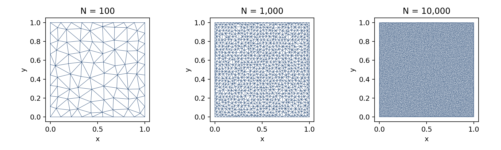
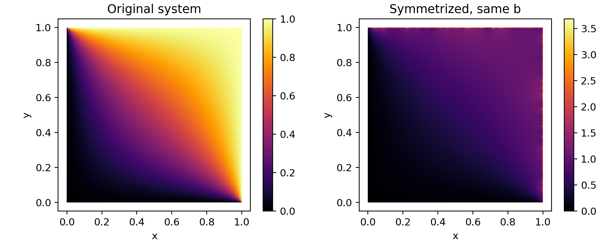

# Laplace Equation on a Unit Square
Finite Element Assembly and Iterative Solver Comparison

11 October 2026

## 1  Domain, boundary conditions and meshes

The domain is 0 < x < 1, 0 < y < 1, with -div(grad T) = 0. Bottom and left edges have T = 0; top and right edges have T = 1. The conflicting values at (1,0) and (0,1) are assigned their mean, 0.5; (0,0) is 0 and (1,1) is 1. Corner values are needed for the discrete model; the continuum data have jumps at two corners.

| Target nodes | Actual nodes N | P1 triangles | Boundary nodes | Interior DOFs |
| --- | --- | --- | --- | --- |
| 100 | 100 | 162 | 36 | 64 |
| 1,000 | 1,000 | 1,874 | 124 | 876 |
| 10,000 | 10,000 | 19,602 | 396 | 9604 |

Gmsh 4.15.2 (algorithm 5) triangulates exactly N prescribed points: equally spaced boundary points and deterministic, stratified, jittered interior points. No extra nodes are inserted. The meshes are unstructured linear triangles, whereas the reference report uses quadrilaterals; its numerical values therefore should not be expected here.

Assembly. For a triangle of area Delta, K_ij = (beta_i beta_j + gamma_i gamma_j)/(4 Delta), with beta_i = y_j-y_k and gamma_i = x_k-x_j. Assemble all local matrices into K. Retain interior rows and replace boundary rows by unit rows to obtain A; b is zero inside and equals the prescribed temperature on boundary nodes. A is nonsymmetric after this row replacement.

Common convergence and initialization. Every accepted run satisfies the true residual ||b-Ax||2/||b||2 <= 10^-8. Maximum: 100,000 iterations. Original runs start with x_B = g and x_I = 0, so boundary residuals remain zero and SD/CG act on the SPD interior block. Symmetrized runs start at zero. Neither system uses a preconditioner. MR is one-step minimal residual, not GMRES or MINRES.

## 2  Original system: dense versus CSR

| N / method | Dense iter. | CSR iter. | Dense time (s) | CSR time (s) | Speedup |
| --- | --- | --- | --- | --- | --- |
| 100 / SOR | 30 | 30 | 0.000219 | 0.000032 | 6.8x |
| 100 / SD | 210 | 210 | 0.000239 | 0.000099 | 2.4x |
| 100 / MR | 207 | 207 | 0.000247 | 0.000097 | 2.5x |
| 100 / CG | 28 | 28 | 0.000034 | 0.000013 | 2.6x |
| 100 / BiCGSTAB | 21 | 21 | 0.000050 | 0.000021 | 2.4x |
| 1,000 / SOR | 109 | 109 | 0.104048 | 0.001617 | 64.3x |
| 1,000 / SD | 2627 | 2627 | 0.315872 | 0.016164 | 19.5x |
| 1,000 / MR | 2583 | 2583 | 0.288221 | 0.015853 | 18.2x |
| 1,000 / CG | 100 | 100 | 0.015266 | 0.000563 | 27.1x |
| 1,000 / BiCGSTAB | 71 | 67 | 0.016933 | 0.000851 | 19.9x |
| 10,000 / SOR | 353 | 353 | 36.766 | 0.071309 | 515.6x |
| 10,000 / SD | 25929 | 25929 | 358.074 | 2.239815 | 159.9x |
| 10,000 / MR | 25523 | 25523 | 351.714 | 2.198128 | 160.0x |
| 10,000 / CG | 301 | 302 | 4.178953 | 0.024625 | 169.7x |
| 10,000 / BiCGSTAB | 187 | 206 | 5.103499 | 0.037672 | 135.5x |

| Nodes N | Empirical optimum omega | CSR SOR iterations |
| --- | --- | --- |
| 100 | 1.455 | 30 |
| 1,000 | 1.815 | 109 |
| 10,000 | 1.940 | 353 |

SOR omega is selected in CSR using a coarse search from 1.00 to 1.95 with step 0.05, followed by a local step-0.005 search within +/-0.05, clipped to [1,1.995]. The best factor minimizes iterations to the same tolerance; ties favor the smaller factor. This is an empirical grid optimum, not a proven continuous optimum. Search trials are retained in results/tuning_N.csv and are excluded from solver times.

Both formats use the same method recurrences and full N-node equations. Dense matrix-vector products use one-thread OpenBLAS; CSR products and SOR sweeps use compiled C loops. The original CG and steepest-descent runs are justified by their invariant interior subspace, rather than by symmetry of the full A.

SD: alpha = (r,r)/(r,Ar). MR: alpha = (Ar,r)/(Ar,Ar). Both update x by alpha*r. CG uses the standard three-term recurrence; BiCGSTAB uses the standard stabilized bi-conjugate gradient recurrence. Recursive residuals are checked against the true residual before accepting convergence.

## 3  Symmetrized system: As x = b

As = (A + A^T)/2 is formed after the boundary rows have been imposed, with b retained exactly. Symmetrization is applied to the full matrix, including its boundary equations. These runs use the identical relative residual threshold, a zero initial guess and a separately tuned SOR factor.

| N / method | Dense iter. | CSR iter. | Dense time (s) | CSR time (s) | Speedup |
| --- | --- | --- | --- | --- | --- |
| 100 / SOR | 32 | 32 | 0.000238 | 0.000036 | 6.6x |
| 100 / SD | 280 | 280 | 0.000317 | 0.000138 | 2.3x |
| 100 / MR | 281 | 281 | 0.000356 | 0.000138 | 2.6x |
| 100 / CG | 40 | 40 | 0.000046 | 0.000020 | 2.4x |
| 100 / BiCGSTAB | 29 | 29 | 0.000068 | 0.000030 | 2.3x |
| 1,000 / SOR | 110 | 110 | 0.105424 | 0.001826 | 57.7x |
| 1,000 / SD | 2750 | 2750 | 0.298211 | 0.017883 | 16.7x |
| 1,000 / MR | 2737 | 2737 | 0.316356 | 0.018106 | 17.5x |
| 1,000 / CG | 107 | 107 | 0.012839 | 0.000597 | 21.5x |
| 1,000 / BiCGSTAB | 75 | 77 | 0.018035 | 0.001062 | 17.0x |
| 10,000 / SOR | 350 | 350 | 36.201 | 0.076805 | 471.3x |
| 10,000 / SD | 25978 | 25978 | 368.635 | 2.434771 | 151.4x |
| 10,000 / MR | 26262 | 26262 | 375.253 | 2.545962 | 147.4x |
| 10,000 / CG | 311 | 311 | 4.659008 | 0.029273 | 159.2x |
| 10,000 / BiCGSTAB | 216 | 187 | 6.391922 | 0.041999 | 152.2x |

| Nodes N | Empirical optimum omega | CSR SOR iterations |
| --- | --- | --- |
| 100 | 1.500 | 32 |
| 1,000 | 1.820 | 110 |
| 10,000 | 1.940 | 350 |

Independent smallest-eigenvalue estimates are positive for all three As matrices (Section 5), so SD and CG have their usual SPD setting here. This observation is specific to these assembled systems: averaging an arbitrary matrix with its transpose does not guarantee positive definiteness.

Small dense/CSR differences in Krylov iteration counts, especially BiCGSTAB, can arise from floating-point summation order. Every listed result is accepted using its true residual, and no failed run is hidden as a successful run.

## 4  Computing time, storage and implementation

The measured dense/CSR speedup ranges from 2.3x to 515.6x. CSR is faster in every listed run. CSR traverses only stored nonzeros, while dense products traverse all N squared coefficients. These timings compare the stated implementations, not only abstract storage formats.

| N | Nonzeros A | Density (%) | Dense (MiB) | CSR (MiB) | Storage ratio |
| --- | --- | --- | --- | --- | --- |
| 100 | 486 | 4.8600 | 0.076 | 0.006 | 12.8x |
| 1,000 | 6,257 | 0.6257 | 7.629 | 0.075 | 101.2x |
| 10,000 | 67,625 | 0.0676 | 762.939 | 0.812 | 939.5x |

Storage above counts matrix payload only: dense float64 values versus CSR float64 values, int32 columns and int32 row pointers. It excludes work vectors, coordinates, allocator overhead, and the retained dense reference. These are representation sizes, not peak memory of the benchmarking program. As has 550, 6,498, 68,410 nonzeros for the three mesh sizes, respectively.

Timing protocol. C11, GCC 14.2.0, -O3 -march=native, IEEE double precision, one-thread OpenBLAS on an AMD EPYC 9V74 cloud CPU. Five repetitions for N=100 and three for N=1000 report the median; N=10000 has one full measured run per case. Timings include initial/final residual products and solver iterations; they exclude parsing, assembly, allocation, conversion, tuning and file output. Cloud scheduling and very short durations limit timing precision; reported speedups are machine-specific. The 10,000-node original-system times and residuals are retained at log precision (six decimal places / three significant digits); stopping uses the unrounded residual.

## 5  What symmetrization changes

| N | Min eigenvalue As | Max boundary error | Relative solution change |
| --- | --- | --- | --- |
| 100 | 0.2163034 | 1.356895 | 0.477239 |
| 1,000 | 0.02082548 | 1.805613 | 0.429962 |
| 10,000 | 0.002008452 | 2.683462 | 0.344414 |

The boundary row of As is no longer a unit equation: boundary/interior couplings are half of those in the original interior rows. Consequently the same b produces different boundary temperatures and a different solution. The maximum boundary error is max |xs_B-g|. Relative change is ||xs-x||2/||x||2, using independent sparse direct reference solves. Original boundary error is zero to numerical precision.

| N | SOR A/As | SD A/As | MR A/As | CG A/As | BiCGSTAB A/As |
| --- | --- | --- | --- | --- | --- |
| 100 | 30/32 | 210/280 | 207/281 | 28/40 | 21/29 |
| 1,000 | 109/110 | 2627/2750 | 2583/2737 | 100/107 | 67/77 |
| 10,000 | 353/350 | 25929/25978 | 25523/26262 | 302/311 | 206/187 |

## 6  Conclusion and independent validation

| N | Direct residual A | Direct residual As | Interior analytic RMS |
| --- | --- | --- | --- |
| 100 | 5.967e-16 | 8.276e-16 | 6.952e-03 |
| 1,000 | 1.526e-15 | 1.658e-15 | 1.927e-03 |
| 10,000 | 2.965e-15 | 3.571e-15 | 7.405e-04 |

The independent Python check reconstructs each element matrix from mesh coordinates, verifies the total area equals one, checks row boundary conditions and As=(A+A^T)/2, and solves both systems with SciPy sparse direct LU. The maximum difference between independently assembled and C-assembled coefficients is 3.375e-14. C CSR-CG solutions agree with the direct solutions to relative errors below 2.411e-08. All 60 final solver/format/system/mesh runs converge; their recorded true residuals are retained in all_runs.csv.

The analytic check uses the harmonic extension u_top(x,y)+u_right(x,y), with u_top = sum over odd k of 4/(k*pi) sin(k*pi*x) sinh(k*pi*y)/sinh(k*pi), and the right-edge term obtained by swapping x and y. Five hundred odd terms and a stable exponential evaluation are used. RMS is measured only at interior nodes of the original solution, because the symmetrized problem no longer imposes the original boundary values. Corner singularities and changing sample locations mean this is an accuracy check, not a controlled convergence-rate estimate.

CSR sharply reduces storage and computing time as N grows. Krylov methods need substantially fewer iterations than unpreconditioned SD and MR here. The fastest measured CSR solver in each case is: N=100, original: CG; N=100, symmetrized: CG; N=1,000, original: CG; N=1,000, symmetrized: CG; N=10,000, original: CG; N=10,000, symmetrized: CG. Empirical optimal SOR is competitive but requires a factor search. Symmetrization changes the physical boundary equations; a smaller residual for As is not evidence that the original heat problem has been solved.

Reproducibility. Deliverables include solver.c, mesh_100.msh, mesh_1000.msh, mesh_10000.msh, this report, generate_meshes.py, validate.py, make_report.py, run.sh and README.md. Raw run CSVs, tuning histories, serialized CSR and Matrix Market matrices, b and nodal solutions are in results/. The reference PDF was used only to guide the section order and table layout; its values and authorship were not reused.

